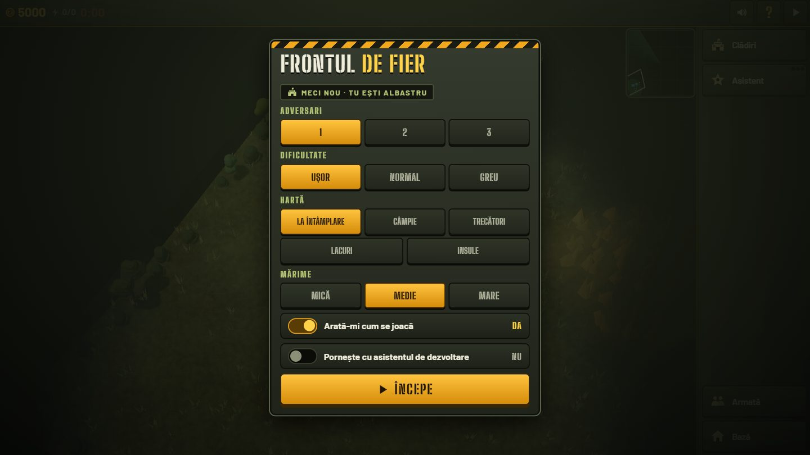
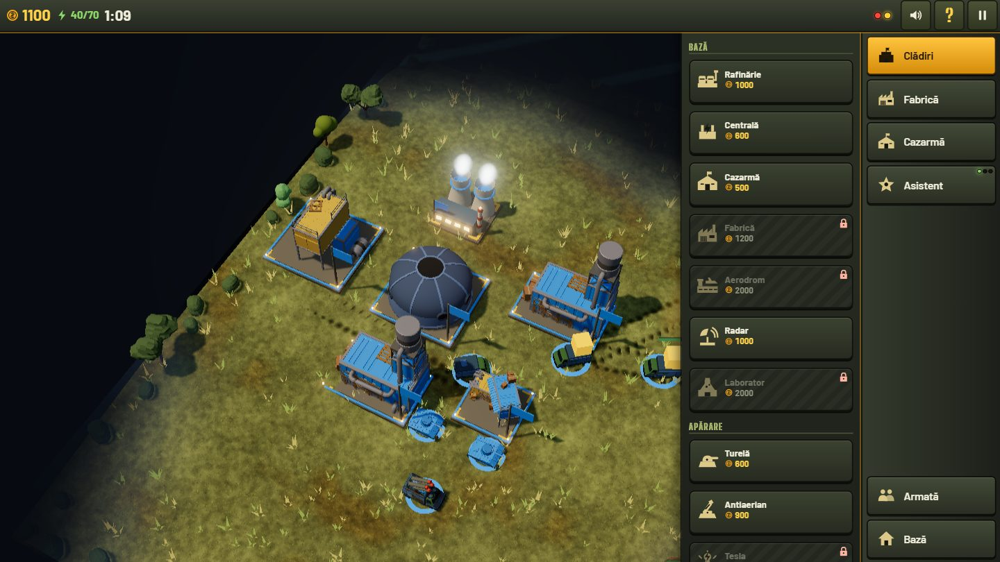
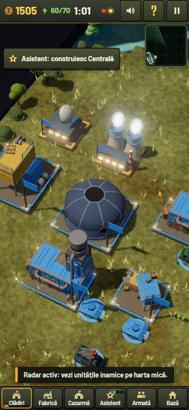
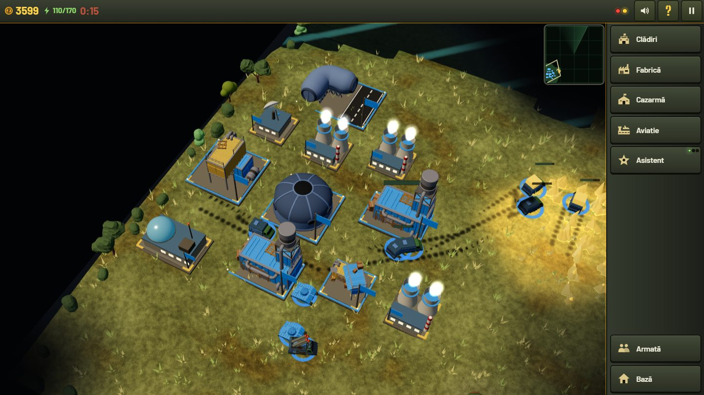

# Frontul de Fier

A 3D real-time strategy game that runs entirely in the browser, inspired by the classic base-building RTS games. Build a base, harvest ore, raise an army and be the last commander standing against up to three AI opponents. It plays with mouse and keyboard on desktop and with touch on phones.

**Play it:** https://frontul-de-fier.vercel.app



> The in-game interface is in Romanian ("Frontul de Fier" means "The Iron Front"). The in-game help sheet (the `?` button) lists every command.

## What is in the game

- **Economy.** Refineries and armored harvesters turn ore into credits. Buildings draw power from power plants; when consumption exceeds production, production slows down and turrets run at half rate.
- **Base building.** 12 structures: headquarters, refinery, power plant, barracks, factory, airfield, radar, laboratory, wall segments that chain automatically, plus defences (cannon turret, anti-air turret, Tesla tower). A tech tree gates the advanced buildings and units.
- **Army.** 9 unit types: soldier, anti-tank trooper, light tank, heavy tank, artillery, rocket launcher, harvester, armored harvester and a bomber. Units that destroy enough targets are promoted to Veteran and then Elite.
- **Fog of war and radar.** You only see what your units and buildings reveal. A powered radar adds enemy units to the minimap.
- **Skirmish setup.** 1 to 3 AI opponents (free-for-all, last one standing wins), three difficulty levels, five map types (random, open field, passes, lakes, islands) and three map sizes.
- **Assistant.** Three independent switches (base development, defence, attack production) that build and manage things for you, useful on a phone.
- **Guard and attack groups.** Each combat unit is either in the attack force or in the guard. The guard holds a post near the base and responds to attacks on buildings and harvesters; the attack force goes on offensives.
- **Production queues** of up to 99 units, repair, sell (half the cost back), control groups, formations, crushing infantry with vehicles.
- **Sound.** Sound effects are synthesized with WebAudio (no sample files); the two music tracks are CC0.
- **Touch UI.** A dedicated phone layout with a bottom dock, build trays, pinch zoom and a tappable radar.

| Build tray (desktop) | Phone layout |
|---|---|
|  |  |



## How to play

1. Press **Begin** on the new match screen. You are the blue team.
2. Your starting units and headquarters are already on the map. Build a **Refinery** and a **Power plant** from the *Buildings* tray, then a **Barracks** and a **Factory**.
3. Send your harvesters to the ore fields. Credits are shown top left, power next to them.
4. Queue units from the barracks, factory and airfield. Put some in the guard, keep the rest for attacking.
5. Add turrets and walls, then a radar, so you see attacks coming. The first enemy wave comes on a visible countdown.
6. Destroy every enemy building and unit to win.

If you would rather focus on fighting, switch on the **Assistant** and let it develop the base.

## Controls

**Mouse and keyboard**

| Input | Action |
|---|---|
| Left click / drag | Select a unit, or draw a selection box. Double click selects all units of the same type on screen |
| Right click | Context order: attack an enemy, harvest ore, or move |
| Mouse wheel | Zoom |
| Screen edges, arrow keys or `W` `A` `S` `D` | Pan the camera |
| `A` | Attack-move |
| `S` | Stop |
| `H` | Jump back to the base |
| `Space` | Jump to the last alert |
| `Ctrl` + `1`..`9`, then `1`..`9` | Save and recall a control group |
| `P` or `F10` | Pause |
| `Esc` | Cancel the current action |

**Touch**

| Input | Action |
|---|---|
| Tap | Select a unit; tap the ground to move, tap an enemy to attack |
| Long press and drag | Selection box |
| One finger drag | Pan the map |
| Two finger pinch | Zoom and pan |
| Bottom dock | Buildings, Factory, Barracks, Aviation, Assistant, Army, Base |

## Tech stack

| Layer | Tooling |
|---|---|
| Language | TypeScript 5.9 (strict) |
| 3D rendering | three.js 0.186 |
| Build | Vite 6 with `vite-plugin-singlefile`: the production build is one self-contained `index.html` |
| Tests | Vitest 3 |
| UI | Plain DOM and CSS, no UI framework |
| Hosting | Vercel (static) |

## Architecture in short

The game is split into three layers that talk through narrow contracts.

```
src/
  sim/      deterministic simulation: no three.js, no DOM, no Math.random
  data/     balance data: unit and building cost, hp, damage, range, speed
  render/   three.js renderer, implements the RenderAPI contract
  ui/       DOM: build trays, minimap, screens, input (mouse, keyboard, touch), audio
  main.ts   wires everything together
reference/  the original 2D prototype (kept as the behaviour reference)
docs/       plan, architecture notes, asset licences, screenshots
```

- **The simulation is deterministic.** It runs on a fixed 20 ticks per second, uses a seeded RNG (mulberry32) and its own trigonometry tables, so the same seed and the same commands always give the same result. There is a hash of the world state and a determinism test. This is what makes lockstep multiplayer and replays possible later.
- **Everything the player does is a `Command`.** The UI and the AI both emit commands; neither touches the world state directly.
- **Rendering only reads the world.** `main.ts` runs the simulation at its fixed rate and renders every animation frame, interpolating positions between ticks. Visual effects start from the simulation's event queue.
- **All balance numbers live in `src/data/`.** There are no magic gameplay numbers in the code.
- **Performance.** Static meshes of each loaded model are merged to cut draw calls, walls and decor are instanced, and a performance test guards the simulation on large armies.

More detail in [`docs/ARCHITECTURE.md`](docs/ARCHITECTURE.md) and the roadmap in [`docs/PLAN.md`](docs/PLAN.md).

## Run it locally

Requires Node.js 20 or newer.

```bash
npm install
npm run dev        # development server
npm run build      # type check + production build into dist/
npm test           # simulation tests (Vitest)
```

## Assets and licences

The code in this repository is the work of Vixon Lab. Third-party assets are all CC0 (public domain):

- 3D models from Quaternius (via poly.pizza)
- Music: "Bleak Terminal" by Ruskerdax and "Battle Theme A" by cynicmusic, both from OpenGameArt

Every file, author and source link is listed in [`docs/ASSETS.md`](docs/ASSETS.md). Buildings and units that have no suitable free model (bomber, power plant, artillery, walls, Tesla tower, radar, laboratory) are built procedurally in code.

## Roadmap

Planned next: more content (a second faction, infantry engineers, more maps), custom 3D art, lockstep multiplayer with invite links, a short campaign and a store release. See [`docs/PLAN.md`](docs/PLAN.md).

---

Built by [Vixon Lab](https://vixonlab.ro), a web studio for fast sites, AI chatbots and automations.
